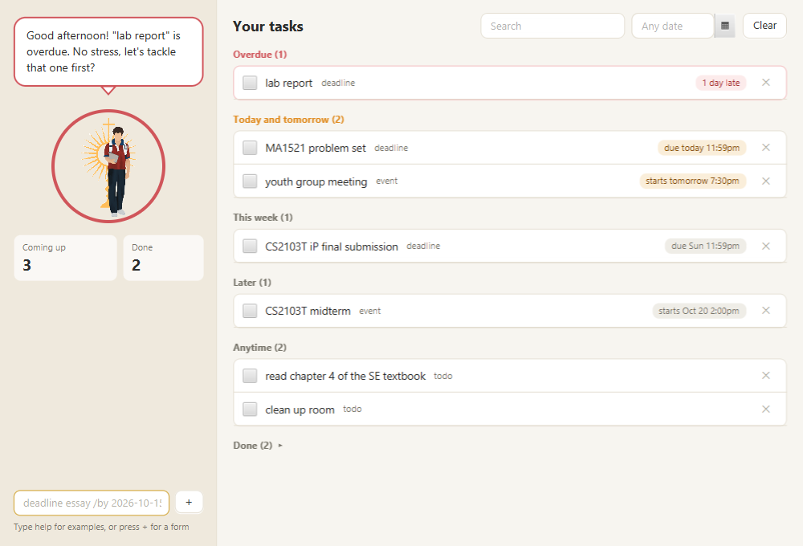

# Carlo User Guide



Carlo is a **desktop app for keeping track of your todos, deadlines, and events**, with
Saint Carlo Acutis as your friendly companion. He greets you with a summary of your day,
cheers you on when you finish something, and reminds you when something is coming up.

Your tasks are grouped by **when they're due**, not by type, so the most urgent things are
always at the top. You can add tasks by typing a short command, or by filling in a form.

* [Quick start](#quick-start)
* [Meet Carlo](#meet-carlo)
* [Features](#features)
    * [Adding a todo](#adding-a-todo)
    * [Adding a deadline](#adding-a-deadline)
    * [Adding an event](#adding-an-event)
    * [Adding a task with the form](#adding-a-task-with-the-form)
    * [How tasks are grouped](#how-tasks-are-grouped)
    * [Marking a task as done](#marking-a-task-as-done)
    * [Editing a task](#editing-a-task)
    * [Deleting a task](#deleting-a-task)
    * [Undoing a change](#undoing-a-change)
    * [Searching by keyword](#searching-by-keyword)
    * [Viewing tasks on a specific date](#viewing-tasks-on-a-specific-date)
    * [Reminders](#reminders)
    * [Getting help](#getting-help)
    * [Supported date/time formats](#supported-datetime-formats)
* [FAQ](#faq)
* [Summary](#summary)

## Quick start

1. Make sure you have **Java 25** installed. You can check by running `java -version` in a
   terminal.
2. Download the latest `carlo.jar` from the [releases page](https://github.com/winstonmulyadinus/ip/releases).
3. Copy the file to the folder you want to use as Carlo's home folder.
4. Open a terminal in that folder and run:
   ```
   java -jar carlo.jar
   ```
   Carlo's window appears in a few seconds, with a summary of your day.
5. Your tasks are saved automatically to `data/carlo.txt` inside that folder after every
   change, and loaded again the next time you open Carlo.

## Meet Carlo

Carlo lives in the sidebar on the left. The **ring around his photo** and the border of his
speech bubble change colour to show how things are going:

| Colour | Meaning |
|---|---|
| Gold | You're on track |
| Amber | Something is due soon, or Carlo needs your attention |
| Red | Something is overdue |

Under his photo, **Coming up** counts the tasks due in the next week, and **Done** counts
the tasks you've finished.

## Features

Commands are typed into the **command bar** at the bottom of the sidebar. Press **Enter** to
send one. If Carlo understands it, the bar clears; if not, he explains what went wrong and
leaves your text there so you can fix it.

### Adding a todo

Adds a task with no date: anything you just need to remember to do at some point.

Format: `todo DESCRIPTION`

Example: `todo read chapter 4 of the SE textbook`

### Adding a deadline

Adds a task that must be done by a certain date, and optionally a certain time.

Format: `deadline DESCRIPTION /by DATE`

Examples:
* `deadline essay /by 2026-10-15`
* `deadline iP final submission /by 2026-10-11 2359`

If you leave out `/by`, the deadline is set to today. A deadline with no time is due by the
end of that day.

### Adding an event

Adds something that starts and ends at certain times.

Format: `event DESCRIPTION /from START /to END`

Examples:
* `event youth group meeting /from 2026-10-10 1930 /to 2026-10-10 2130`
* `event retreat /from 2026-10-20 /to 2026-10-22`

The start must not be after the end, or Carlo will ask whether you mixed them up.

### Adding a task with the form

Prefer not to type commands? Click the **+** button next to the command bar, or press
**Ctrl+N** (**Cmd+N** on a Mac). Choose the type of task, enter a description, and pick the
dates from the calendar. Times are optional and typed as `HHmm`, e.g. `1800` for 6pm.

### How tasks are grouped

Tasks are sorted into groups, most urgent first, and sorted by date within each group:

| Group | What's in it |
|---|---|
| **Overdue** | Deadlines that have passed, and events that have ended, that you haven't ticked off |
| **Today and tomorrow** | Anything due or starting today or tomorrow, and events happening right now |
| **This week** | Anything due or starting in the next 7 days |
| **Later** | Anything further away |
| **Anytime** | Todos, which have no date |
| **Done** | Finished tasks. Click the heading to show or hide them. |

Each task shows when it's due in plain words, such as `due today 11:59pm`, `starts Sun`, or
`2 days late`. These update by themselves while Carlo is open.

### Marking a task as done

Tick the checkbox next to the task. It moves to the **Done** group, and Carlo congratulates
you. Untick it to put it back on your list.

You can also right-click a task and choose **Mark as done** or **Mark as not done**.

### Editing a task

**Double-click** a task, or right-click it and choose **Edit**. The form opens with the
task's details filled in. Change whatever you like, including its type (for example, turning
a todo into a deadline), then click **Save**. The task keeps its place in the list, and stays
done if it was done.

### Deleting a task

Click the **✕** at the right end of the task, or right-click it and choose **Delete**.

### Undoing a change

Made a mistake? Click **Undo** in Carlo's speech bubble, or press **Ctrl+Z** (**Cmd+Z** on a
Mac). This works for adding, editing, ticking off, and deleting tasks. You can undo up to
20 changes, one at a time.

While you're typing in a text box, Ctrl+Z undoes your typing instead. Click outside the box
first to undo a change to your tasks.

### Searching by keyword

Type into the **Search** box at the top right. The list instantly shows only tasks whose
description contains what you typed (upper or lower case doesn't matter). Click **Clear** to
see everything again.

### Viewing tasks on a specific date

Pick a date with the calendar button next to the search box, or type it in. The list shows
deadlines due on that date and events happening on it. You can combine this with a keyword
search. Click **Clear** to remove both filters.

### Reminders

While Carlo is open, he checks every minute for deadlines and events with a set time that
are **due or starting within the next 30 minutes**, and reminds you once in his speech
bubble. Tasks with only a date (no time) don't get reminders, since there's no particular
moment to remind you about.

### Getting help

Type `help` into the command bar, and Carlo shows examples of each command.

### Supported date/time formats

These work in the command bar. (In the form, pick dates from the calendar instead.)

| Format | Example |
|---|---|
| `yyyy-mm-dd` | `2026-10-15` |
| `yyyy-mm-dd HHmm` | `2026-10-15 1800` |
| `d/m/yyyy` | `15/10/2026` |
| `d/m/yyyy HHmm` | `15/10/2026 1800` |
| Relative keyword | `today`, `tomorrow`, `yesterday` |

## FAQ

**Q: Do I need to save my data manually?**<br>
A: No. Carlo saves after every change to `data/carlo.txt` in his home folder.

**Q: How do I move my data to another computer?**<br>
A: Install Carlo on the other computer, then replace the `data/carlo.txt` it creates with
the one from your old home folder.

**Q: Carlo won't start, and the terminal shows `UnsupportedClassVersionError`.**<br>
A: Your Java is too old. Check that `java -version` shows version 25, and install Java 25
if it doesn't.

## Summary

| Action | How |
|---|---|
| Add a todo | `todo DESCRIPTION` |
| Add a deadline | `deadline DESCRIPTION /by DATE` |
| Add an event | `event DESCRIPTION /from START /to END` |
| Add with a form | Click **+**, or press **Ctrl+N** |
| Mark done / not done | Tick or untick the checkbox |
| Edit | Double-click the task, or right-click and choose **Edit** |
| Delete | Click **✕**, or right-click and choose **Delete** |
| Undo | Click **Undo** in Carlo's speech bubble, or press **Ctrl+Z** |
| Search | Type in the **Search** box |
| Show tasks on a date | Pick a date next to the search box |
| Clear search and date | Click **Clear** |
| Help | `help` |
